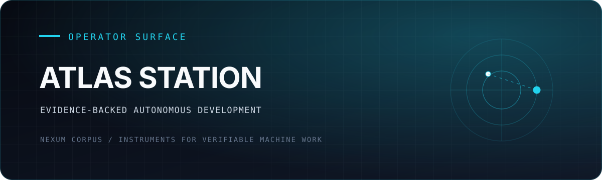

<div align="center">
  

  <p><strong>A desktop organism that can speak, inspect, build, remember, and show its receipts.</strong></p>

  <p><a href="#run-atlas">Run Atlas</a> · <a href="#what-you-can-see">Capabilities</a> · <a href="./ARCHITECTURE.md">Architecture</a> · <a href="https://github.com/NexumCorpus">Nexum Corpus</a></p>
</div>

---

Atlas Station is the desktop executive surface of Hermes, a local organism for
evidence-backed autonomous development and discovery. Atlas is the mouth and
executive cortex; Station is the continuity spine and notary; tools, skills,
shards, crystals, graders, and background metabolism form the rest of the body.

The interface is designed to make execution legible: current provider, assigned
model, active lane, tool calls, elapsed work, durable claims, and failures remain
visible instead of disappearing behind a chat bubble.

The current executive route is:

```text
operator -> ATLAS / Hermes -> OpenRouter -> runtime-selected model -> local tools
```

Provider and model identity are injected from current runtime authority and
recorded in signed attempt metadata. Stale memory is never allowed to decide
which model claims to be executing.

## What you can see

- Role-aware direct conversation that survives autonomous background work.
- Deadline-bounded autonomy with idle discovery, retry, and stale-timer repair.
- Loss-aware context injection, durable crystals, and byte-exact shard recovery.
- External Wing v1 lifecycle with Director2 felt-state integration.
- Independent claim grading with explicit certified, rejected, and null states.
- An end-to-end discovery mission path with append-only evidence.
- Sidecar-generation-aware Electron UI with transparent provider, model, task,
  failure, and autonomy state.
- Inverse metabolism that turns recurring negative evidence into proof-bound
  contracts for eliminating the source of work rather than accelerating it.
- A proposal-only obligation compiler that detects consented multilateral
  novation cycles while preserving every participant's declared face position.
- One machine-readable release contract and one full readiness command.

## Run Atlas

Requirements: Windows, Node.js 24, Python 3, and either an OpenRouter API key or
a local [Ollama](https://ollama.com) model (no key, no per-token cost).

```text
npm ci
npm test            # behavioral suite, no network or API key needed
# create .env (gitignored) with ONE of the two routes below
npm start
```

Platform support: the desktop app (`npm start`) is developed and tested on
Windows. On Linux, `npm ci` and `npm test` pass and the wider suite runs once
the sibling repositories in [docs/TESTING.md](docs/TESTING.md#full-test-surface)
are in place. Launching the app on Linux or macOS is untested.

Cloud route (default):

```env
OPENROUTER_API_KEY=...
# Any tool-calling model id from https://openrouter.ai/models. The id below
# was listed on 2026-10-20 and is an example, not a recommendation.
ATLAS_OPENROUTER_MODEL=deepseek/deepseek-chat
```

Set the model explicitly. The built-in fallback, `stealth/ox-alpha`, was not in
OpenRouter's public model list on 2026-10-20.

Key-free local route (run `ollama pull qwen3.5:9b` first; see
[docs/LONG-MIND.md](docs/LONG-MIND.md)):

```env
ATLAS_PROVIDER=ollama
ATLAS_OLLAMA_API_URL=http://127.0.0.1:11434/api/chat
ATLAS_OLLAMA_MODEL=qwen3.5:9b
```

`ATLAS_PROVIDER` accepts `openrouter` (default), `ollama`, and `abliteration`.
Authenticated Codex/Claude worker routes are disabled by design.

To inspect or run the local Work-Eater organ:

```text
npm run work:eat:dry
npm run work:eat
node scripts/atlas-tool.cjs abolish_work --limit=3 --dry-run

# Freeze and verify a read-only sample of public $100+ code bounties.
# This produces an unapproved local preflight packet; it never submits work.
npm run economic:scan
node scripts/atlas-tool.cjs inspect_source --query=obligation --path=scripts
npm run obligations:proof
```

The Atlas bridge invokes these organs without a second model or worker. The
obligation proof fetches exact bytes from four SEC EDGAR filings: an executed
five-party agreement, its closing and final settlement, and an active ten-year
capacity contract. It reports the observed $51,703,516 exchange value but never
mislabels that amount as savings. `npm run obligations:diagnostic` retains a
fictional cycle strictly for deterministic parser and solver diagnosis.

`inspect_source` is the organism's fail-closed self-sight route when indexed
semantic search is unavailable. It scans only bounded source extensions inside
the repository, never follows symlinks or runtime stores, and returns exact line
coordinates plus source hashes. Every response carries a `limits` object (files,
bytes per file, total bytes, query length and terms, results) next to what the
scan actually used, and the path must stay inside the repository.

`npm run economic:scan` exits 3 when none of its sources could be read, so a
failed scan is not mistaken for an empty market.

The app starts the fleet sidecar automatically, using Node from `NODE_BIN`, then
the standard Windows install, then the first `node` on `PATH`. If the sidecar
keeps exiting right after launch, restarts back off from 1 s up to 60 s and the
window shows why. Runtime state and build worktrees default to the checkout
(`ATLAS_REPO`) and a sibling `atlas-wt` folder (`ATLAS_WT`). The bottom composer
speaks to ATLAS; fleet cards expose delegated work. Local execution authority is
explicit through the provider route and remains bounded by the operator's
requested scope.

Some operator scripts outside this quickstart (`ask.mjs`, `daemon-run.mjs`,
`instruct_atlas.mjs`, `selfbuild.mjs`, `stigma-*.mjs`, `tools/seed-fact-graph.mjs`,
`zeta-mesh.cjs`, `scripts/spiral-receipt.cjs`, `scripts/tap-runner.mjs`) still
assume the author's `E:\` layout.

## Verify v1

```text
npm run v1:status
npm run v1:verify
npm run v1:release
```

- `v1:status` checks contract shape, required organs, that the selected route is
  a supported one (never a disabled Codex/Claude route), model assignment,
  provider configuration (a key is set, or the route is local), and
  documentation truth. It does not call the provider. It reads `.env` the same
  way the app does, so it is `not-ready` until a route is configured.
- `v1:verify` runs the full acceptance surface and Station's whole-organism
  rehearsal, then writes the runtime receipt `.atlas/v1-readiness.json` without
  mutating the source tree it attests. It needs the sibling repositories from
  [docs/TESTING.md](docs/TESTING.md#full-test-surface) and a checkout of
  [NexumCorpus/station](https://github.com/NexumCorpus/station); set
  `STATION_CLI` to its `station.py` (default `E:\station\station.py`). Without
  them it reports `not-ready` and names what is missing.
- `v1:release` repeats those checks and additionally requires a clean worktree.

The detailed contract and limitations are in [docs/V1.md](docs/V1.md). Testing
coverage is documented in [docs/TESTING.md](docs/TESTING.md), and the retained
(disabled) Codex adapter is described in
[docs/CODEX_PROVIDER.md](docs/CODEX_PROVIDER.md).

## Architecture

- `main.cjs`: Electron lifecycle and renderer/sidecar IPC.
- `fleethost.mjs`: ATLAS orchestration, fleet, autonomy, and organism tools.
- `providers/openrouter.mjs`: the OpenRouter, Ollama, and abliteration routes.
- `providers/codex-cli.mjs`: retained Codex CLI adapter; its routes are disabled.
- `memcontext.cjs`, `session-log.cjs`, `continuity.cjs`: context, direct dialogue,
  and loss-aware circulation.
- `wing-host.cjs`, `wings/director2/`: external organ protocol and discovery wing.
- `grader.cjs`, `scripts/mission-run.mjs`: generator-independent certification
  and mission execution.
- `index.html`, `preload.cjs`: transparent operator cockpit.
- `v1.contract.json`, `scripts/v1-readiness.cjs`: release truth and evidence.

## Safety

Hermes v1 does not autonomously publish, spend money, contact third parties, or
promote its own hypotheses to verified claims. Those actions require explicit
operator authority and independent evidence where applicable.
